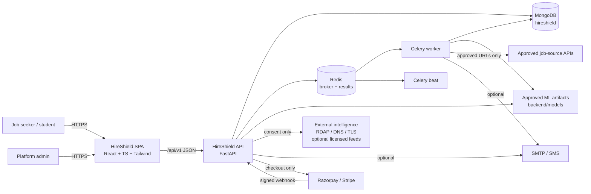
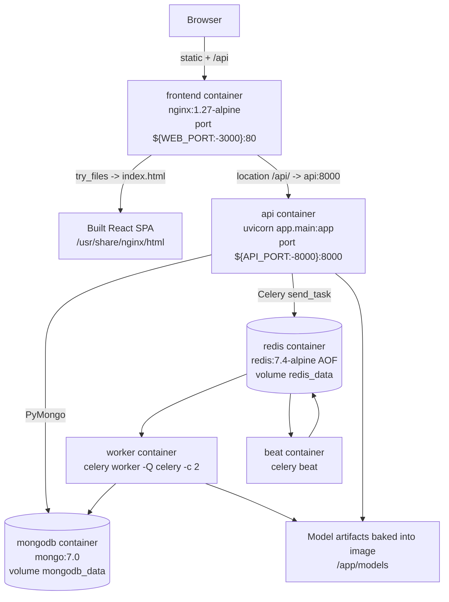
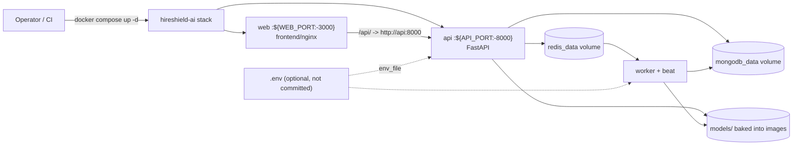

# HireShield AI — Architecture

This document describes the implemented system only. Evidence is drawn from the running source under `backend/app/`, `frontend/src/`, `docker-compose.yml`, and `frontend/nginx.conf`. The legacy `legacy-threat-intel/` directory is out of scope and was not modified.

## 1. Product shape

HireShield AI is a recruitment-fraud investigation SaaS: users submit job postings, messages, URLs or documents; the platform combines local ML, rules, consented external intelligence and historical patterns into an explainable risk assessment, persists evidence, and produces reports and alerts. Administration, subscriptions and scheduled monitoring are first-class parts of the same API.

| Concern | Implementation | Primary source |
| --- | --- | --- |
| API | FastAPI, prefix `/api/v1`; root `/` and `/health` | `backend/app/main.py` |
| Persistence | MongoDB via `MongoDBService` + repository layer | `backend/app/db/mongo.py`, `backend/app/db/repositories.py` |
| Automation | Celery workers + beat, Redis broker/result backend | `backend/app/workers/celery_app.py`, `backend/app/workers/tasks.py` |
| ML | Approved job-text artifacts; honest rule-based fallbacks for message/anomaly where models are rejected | `backend/app/ml/inference/predictor.py`, `backend/models/model_manifest.json` |
| Intelligence | Consent-gated RDAP/DNS/TLS, optional threat feeds, registry, SSRF-safe fetch | `backend/app/intelligence/` |
| Risk | Six-component weighted, verification-aware scoring | `backend/app/core/risk_engine.py` |
| UI | React + TypeScript + Tailwind SPA, routes guarded by role | `frontend/src/App.tsx`, `frontend/src/components/ProtectedRoute.tsx` |
| Billing | Razorpay/Stripe checkout; browser opens Razorpay Checkout with a server-created order; activation only from signed webhooks | `backend/app/billing/payments.py`, `backend/app/api/routes/billing.py`, `frontend/src/lib/razorpay.ts`, `frontend/src/pages/BillingPage.tsx` |
| Deployment | Docker Compose: mongodb, redis, api, worker, beat, frontend/nginx | `docker-compose.yml` |

**Local configuration status:** a root `.env` exists with Razorpay **test** keys, a generated webhook secret and `PAYMENT_CURRENCY=INR` (never commit it). All other API keys and SMTP/SMS credentials remain empty. `/system/config` reports Razorpay as enabled in test mode and Stripe/other providers as unconfigured; unconfigured providers are reported as unavailable, never simulated (`backend/app/core/config.py`, `backend/app/api/routes/system.py`).

## 2. System context



**Data flows at the boundary**

- **No fabricated intelligence.** `DomainAnalyser` returns `not_configured` sections when VirusTotal, Safe Browsing or Web Risk keys are absent; `CompanyVerifier` returns `not_configured` for an unlicensed corporate registry and `not_attempted` without separate registry consent (`backend/app/intelligence/domain_analysis/analyser.py`, `backend/app/intelligence/company_verification/verifier.py`).
- **Consent is a hard gate.** `AnalysisService.run()` skips URL/domain/company lookups unless `consent_external_lookups` is true, and records `missing_evidence`/`technical_limitations` instead. Company verification has a second `consent_corporate_registry_lookup` gate.
- **Network egress is constrained.** `SafeURLFetcher` validates scheme, host, port and every DNS answer, pins connections to validated public IPs, follows redirects manually, allows text content types only, and caps bytes/time (`backend/app/intelligence/url_scanning/safe_fetch.py`).
- **Payments are external.** Checkout creation calls provider APIs only when configured; a browser redirect is informational only. Subscription activation/cancellation is driven exclusively by HMAC-verified webhook events.

## 3. Container view



| Container | Responsibility | Health / dependencies |
| --- | --- | --- |
| `frontend` | Serves the SPA; proxies `/api/` to `api:8000` with the full URI preserved; answers `/health` with a static `200 ok` | Depends on `api: service_healthy` (`frontend/nginx.conf`) |
| `api` | All HTTP endpoints, auth, analysis, reports, webhooks, admin | Waits for healthy mongodb + redis; healthcheck `curl /health` (`docker-compose.yml`) |
| `worker` | Runs monitoring, domain refresh, analytics and health-check tasks | Waits for mongodb/redis healthy and api started |
| `beat` | Publishes the configured schedules to Redis | Same dependencies as worker |
| `mongodb` | Durable primary store, `mongo:7.0` | Healthcheck `mongosh ping`; named volume `mongodb_data` |
| `redis` | Celery broker/result backend with AOF | Healthcheck `redis-cli ping`; named volume `redis_data` |

Development without Compose uses Vite on `http://localhost:5173` with `/api` proxied to `http://localhost:8000` (`frontend/vite.config.ts`) and an API process using `mongodb://localhost:27017` / `redis://localhost:6379/0` by default.

## 4. Request path and analysis flow

### 4.1 Common HTTP behaviour

1. `main.py` adds security headers on every response (`X-Content-Type-Options`, `X-Frame-Options`, `Referrer-Policy`, `Permissions-Policy`, `Cross-Origin-Opener-Policy`, CSP; HSTS in production) and applies `TrustedHostMiddleware` unless `ALLOWED_HOSTS` contains `*`. CORS origins come from settings; credentials are allowed.
2. For `/api/*` requests except `/api/v1/auth/refresh`, a valid `Bearer` access token increments `api_usage` for the user and UTC hour bucket (`backend/app/main.py` middleware, `ApiUsageRepository.increment`).
3. `get_current_user` validates the access token, rejects revoked `jti` values in `token_blacklist`, and requires an active user. `require_role`/`require_admin` enforce the hierarchy `user = student < staff < admin < owner` (`backend/app/api/deps.py`, `backend/app/core/security.py`).
4. `enforce_rate_limit` is applied to registration, login, forgot-password and the four analysis submission routes: 120 requests per client IP **and path** per 60-second in-process sliding window (`backend/app/api/deps.py`). Note `SETTINGS.rate_limit_per_minute` exists but the dependency currently uses a fixed `limit=120`.
5. Errors use a uniform `{"detail": ...}` body: validation errors return a list of `{loc, msg}` with 422; database errors 503; unhandled errors 500 with a generic message. See `docs/API.md`.

### 4.2 Analysis sequence

```mermaid
sequenceDiagram
    participant UI as React SPA
    participant API as FastAPI /analysis/*
    participant PLAN as PlanService
    participant DB as MongoDB repositories
    participant PIPELINE as AnalysisService
    participant ML as TextPredictor
    participant EXT as Consented providers
    participant RISK as Risk engine
    participant NOTE as NotificationService

    UI->>API: POST job/message/url/document + Bearer token
    API->>API: JWT, RBAC, rate limit, upload validation
    API->>PIPELINE: run(user_id, type, payload)
    PIPELINE->>PLAN: can_scan(user_id)
    PLAN-->>PIPELINE: allowed or 402 plan limit
    PIPELINE->>DB: find_idempotent(client_request_id)
    alt duplicate request id
        DB-->>PIPELINE: existing analysis
        PIPELINE-->>API: existing result
    else new analysis
        PIPELINE->>DB: insert status=pending, redacted preview, sha256
        PIPELINE->>PIPELINE: extract entities; parse document text if needed
        PIPELINE->>ML: predict_job / predict_message
        PIPELINE->>EXT: only if consent: safe fetch, RDAP/DNS/TLS, registry, feeds
        EXT-->>PIPELINE: evidence, limitations, sources_succeeded
        PIPELINE->>DB: AnomalyEngine counts (analyses, job_listings, blacklist)
        PIPELINE->>RISK: score_risk(ml, rules, domain, company, history, message)
        RISK-->>PIPELINE: score, category, coverage, evidence, actions
        PIPELINE->>DB: insert risk_indicators; update fraud_analyses=completed
        PIPELINE->>PLAN: consume_scan(user_id)
        opt score >= 60
            PIPELINE->>NOTE: high_risk_notification (in-app + optional email)
        end
        PIPELINE-->>API: AnalysisResult
    end
    API-->>UI: 200 AnalysisResult (or error)
```

Key behaviours verified in `backend/app/services/analysis_service.py`:

- The stored preview redacts emails, Indian-style phone numbers and URLs; `input_sha256` preserves a hash without storing raw text in the preview.
- Idempotency uses `(user_id, client_request_id)`; when absent, the service generates an `auto-<uuid>` storage key. `fraud_analyses.uniq_idempotency` is a unique, sparse compound index.
- Job/document/monitoring text uses the job model; messages use the message model; an anomaly prediction is appended from structured features. Models are only loaded when marked `approved: true`; otherwise named `*_rule_fallback` predictions with explicit limitations are returned (`backend/app/ml/inference/predictor.py`).
- `score_risk` renormalises weights over *available* components, boosts verified malicious/verified-inconsistency evidence (+25) and confirmed malicious reputation (+28), and marks low coverage `inconclusive = true` rather than treating missing lookups as clean (`backend/app/core/risk_engine.py`).
- Every indicator is written to `risk_indicators` with its `analysis_id`; the result is written back to `fraud_analyses`. On any exception the analysis remains persisted with `status = "failed"` and an error field.
- Reports are generated on demand: `GET /reports/{id}` returns metadata; `GET /reports/{id}/pdf` streams a generated PDF and caches it as base64 in `reports` (`backend/app/api/routes/reports.py`, `backend/app/utils/reporting.py`).

## 5. Background automation

`backend/app/workers/celery_app.py` configures Redis when `celery_enabled` is true, `task_acks_late`, worker loss rejection, 3 retries, prefetch 1, 1-hour result expiry and UTC. Beat schedules:

| Schedule | Task | Default cadence |
| --- | --- | --- |
| `collect-monitoring-listings` | `app.workers.tasks.run_monitoring` | every `MONITORING_INTERVAL_MINUTES` (60) |
| `refresh-domain-intelligence` | `refresh_domain_intelligence` | every `DOMAIN_REFRESH_INTERVAL_HOURS` (24) |
| `aggregate-analytics` | `aggregate_analytics` | every 6 hours |
| `system-health-check` | `health_check` | every `HEALTH_CHECK_INTERVAL_MINUTES` (5) |

`run_analysis_task` exists for queued analysis and records state in `task_status`; `run_monitoring` fetches only `JOB_SOURCE_URLS`, upserts listings by fingerprint and emits deduplicated notifications; `aggregate_analytics` writes a snapshot to `platform_settings`; `health_check` appends a document to `health_checks`. Workers build their own services in `backend/app/workers/context.py`, which calls `mongo.connect()`/`setup()` and does **not** use the in-memory fallback.

## 6. Billing and entitlement flow

```mermaid
sequenceDiagram
    participant UI as Billing page
    participant API as /api/v1/billing
    participant PAY as Razorpay/Stripe
    participant DB as MongoDB
    participant HMAC as Webhook verifier

    UI->>API: POST /billing/checkout (plan, provider, approved redirect URLs)
    API->>PAY: create order/session with credentials
    PAY-->>API: checkout_id / checkout_url / key_id
    API-->>UI: CheckoutOut (no entitlement granted)
    UI->>PAY: user completes payment; success/cancel redirect only
    PAY->>API: POST /billing/webhooks/{provider} with raw body + signature
    API->>HMAC: HMAC-SHA256 over raw body (Stripe also checks 5-min tolerance)
    HMAC-->>API: verified event or 400
    API->>DB: idempotency check on provider_event_id
    API->>DB: upsert subscription status/limit/period; append raw event to payments
    API-->>PAY: processed / already_processed
```

- `PlanService.can_scan()` enforces `active`/`trialing` status and `scans_used < scan_limit`; `consume_scan()` increments usage after a successful analysis (`backend/app/services/plan_service.py`).
- `/billing/subscription/cancel` only sets `cancel_at_period_end`; the code comment explicitly states that status changes still happen only via webhook (`backend/app/api/routes/billing.py`).
- Missing payment credentials produce `503` (`PaymentConfigurationError`), never a simulated checkout. Unknown webhook providers return `404`; invalid signatures return `400`.

## 7. Deployment topology



Operational notes:

- `docker-compose.yml` uses an optional `.env` (`required: false`) for all backend services. No secrets are present in the repository; production must supply `SECRET_KEY`, database/broker URIs, CORS/allowed hosts and any provider credentials via the environment.
- `mongodb` and `redis` are not published to the host in Compose; only `api` and `frontend` expose configured host ports. Neither container defines credentials in the Compose file.
- MongoDB startup uses `connect()` (ping) then `setup()` (create collections, validators, indexes). In `production`/`prod`, failure to connect re-raises and the API refuses to start — fail closed. In other environments it logs a warning and switches to `mongomock://`; `/health` and `/api/v1/health` then report `in_memory_fallback: true` and `status: degraded` (`backend/app/main.py`). In-memory data is not durable.
- `/health` on the API container is the real health endpoint; the frontend nginx `/health` is a static probe. Use `/api/v1/health` through the SPA origin for combined database and broker status.
- Swagger UI (`/docs`) and OpenAPI JSON are disabled when `ENVIRONMENT=production`; ReDoc is disabled everywhere.

## 8. Security posture and assurance

| Area | Control | Evidence |
| --- | --- | --- |
| Passwords/tokens | Argon2id hashing; HS256 JWTs with `sub`, `type`, `iat`, `exp`, `jti`; 30-minute access / 14-day refresh; logout blacklists `jti` | `backend/app/core/security.py`, `backend/app/api/routes/auth.py` |
| Authorisation | Role hierarchy and explicit ownership checks for analyses, reports and monitoring tasks; admin-only dashboards/config/task triggers | `backend/app/api/deps.py`, route modules |
| Rate limiting / usage | In-process sliding window on selected routes; per-user hourly `api_usage` accounting from middleware | `backend/app/api/deps.py`, `backend/app/main.py` |
| Uploads | Declared-MIME allowlist, size cap (10 MB), magic-byte checks, sanitised names | `backend/app/core/security.py`, `backend/app/api/routes/analysis.py` |
| External fetching | SSRF-resistant pinned fetcher; consent gates; approved job sources only | `backend/app/intelligence/url_scanning/safe_fetch.py`, `backend/app/workers/tasks.py` |
| Auditability | `audit_logs` for registration, login/logout, verification, monitoring, company checks, checkout, webhook and admin changes | `AuditRepository.log` call sites |
| Secrets | Env-only configuration; `public_dict()` masks configured secrets and `/system/config` exposes only capability booleans | `backend/app/core/config.py`, `backend/app/api/routes/system.py` |

**Verification performed:** backend `pytest backend/tests -q` → 64 passed; frontend `npm test -- --run` → 23 passed across 6 files; `npm run build` → successful. CI also compiles backend sources, trains a model smoke test, validates Compose and builds both images (`.github/workflows/ci.yml`).

## 9. Documentation map

- `docs/DATABASE.md` — collections, validators, indexes, retention, fallback and backup/restore.
- `docs/API.md` — complete endpoint inventory, auth/RBAC, schemas, errors, rate limits and webhook contracts.
- `docs/RAZORPAY_SETUP.md` — Razorpay keys, webhook registration, plan pricing, test-mode purchase and go-live steps.
- Source of truth for runtime behaviour: `backend/app/main.py` and the modules referenced in the tables above.
