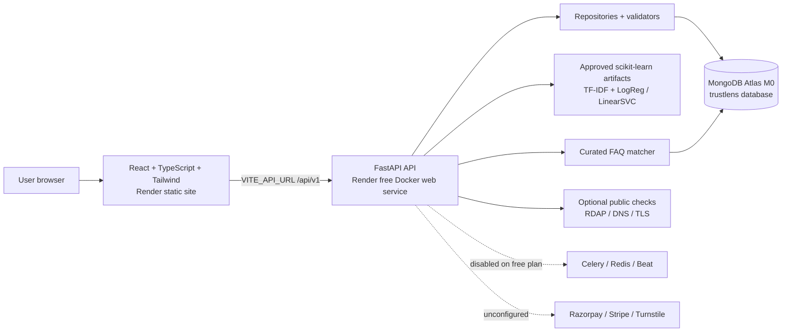

# TrustLens AI — presentation and demo guide

Use this guide to present the project honestly: what is built, what is actually wired, what is disabled, and what evidence proves it.

For a visual opener, use the configured deployment URL. If the legacy `hireshield-*` Render hostname is still present, introduce it as a compatibility key, not the product name; the canonical definition is [TRUSTLENS_CONCEPT.md](../TRUSTLENS_CONCEPT.md). The interactive 3D hero explains the internal request path: browser → FastAPI → repositories → MongoDB → approved ML → evidence response. Its source is `frontend/src/components/ArchitectureScene3D.tsx`.

## 1. One-line pitch

> TrustLens AI is an explainable online-offer verification app: FastAPI + MongoDB Atlas + scoped, approved scikit-learn text models + a React frontend, deployed as a free Render evaluation stack with a docs-backed support chatbot. Recruitment is one offer category.

Do **not** call it a finished commercial SaaS launch. The current status is **evaluation deployment live; production launch NO-GO**.

---

## 2. Suggested 10-slide story

| # | Slide | What to say | What to show |
| --- | --- | --- | --- |
| 1 | Title | “TrustLens AI — verify before you act, decide with evidence.” | Live frontend URL. |
| 2 | Problem | Fake offers, adverts, messages and links mix real signals with pressure tactics. A single score is not enough. | Landing page / scanner screen. |
| 3 | What it does | Extracts signals, combines approved text models + rules + optional public-source checks, then explains evidence and limitations. | `README.md` → “What it does”. |
| 4 | Architecture | Browser → Render static site → FastAPI API → MongoDB Atlas; model artifacts loaded from the repo. | Mermaid diagram below. |
| 5 | Backend | Typed Pydantic APIs, auth/RBAC, rate limit, security headers, health/config endpoints, fail-closed production DB. | `/health`, `/api/v1/system/config`, `docs/API.md`. |
| 6 | MongoDB | Atlas M0 stores users, analyses, audit logs, plans, reports and support chat logs. Repositories centralise access; validators and TTL indexes exist. | Atlas collections or API proof below. |
| 7 | ML model | Approved EMSCAD job models plus optional DIFrauD message/job models; generic offers stay rule-only; only `approved: true`, loadable artifacts run. | `backend/models/model_manifest.json`. |
| 8 | Frontend + chatbot | React + Tailwind UI; global docs-backed support widget with saved history and clear action. | Open “Ask TrustLens”. |
| 9 | Honest limits | No calibrated probabilities, no live billing/Turnstile/commercial feeds, no workers/cron on free plan, no production launch. | `docs/LAUNCH_READINESS.md`. |
| 10 | Roadmap | Retention/legal/security/observability/backups, then staged production release. | Launch readiness action list. |

---

## 3. Live demo script — about 10 minutes

Keep these tabs ready:

1. Frontend: <https://hireshield-web-j72o.onrender.com>
2. API health: <https://hireshield-api-wets.onrender.com/health>
3. API config: <https://hireshield-api-wets.onrender.com/api/v1/system/config>
4. GitHub repo: <https://github.com/Sanukrrajput/hireshield-ai>
5. Atlas cluster UI — open to the `trustlens` database, but **blur/hide the connection string**
6. `backend/models/model_manifest.json`
7. `docs/LAUNCH_READINESS.md`

> Free Render services sleep after roughly 15 minutes of inactivity. The first request may take about a minute. Say this before clicking. The legacy `hireshield-*` hostnames in the URL list below are retained compatibility keys, not product branding.

### Step A — prove the backend and database are alive

Show `/health`. Point to:

- `status: ok`
- `environment: production`
- `database.database: connected`
- `database.name: trustlens`
- `in_memory_fallback: false`

Then show `/api/v1/system/config` and say:

- `billing_enabled: false`
- `turnstile: false`
- `job_monitoring: false`
- external providers are reported, not simulated

### Step B — submit a scan in the UI

Use obviously synthetic text, for example:

> Urgent remote vacancy. Pay a refundable registration fee today and share a scan of your government ID. No interview. Reply only on this chat.

Walk through:

1. Paste into the scanner.
2. Do not consent to external lookups unless you want to explain the RDAP/DNS/TLS path.
3. Submit.
4. Point to the **risk band**, **component scores**, **evidence statuses**, **sources attempted/succeeded** and **limitations**.
5. Say: “The score is evidence strength for review, not proof of fraud or safety.”

### Step C — show MongoDB persistence

Best option: in Atlas, open `trustlens` → Collections → `support_messages` or `fraud_analyses` and point at the newest document. Explain the fields without exposing secrets.

If you do not want to show Atlas, prove it through the API:

```powershell
$base = 'https://hireshield-api-wets.onrender.com/api/v1/support/chat'
$session = 'demo-' + [guid]::NewGuid().ToString('N')
$body = @{ message = 'How is the risk score calculated?'; session_id = $session } | ConvertTo-Json

Invoke-RestMethod -Method Post -Uri $base -ContentType 'application/json' -Body $body
Invoke-RestMethod -Uri ($base + '?session_id=' + $session)
Invoke-RestMethod -Method Delete -Uri ($base + '?session_id=' + $session)
```

Point out:

- `POST` stores the user question and assistant answer.
- `GET` returns them in order with roles `user` and `assistant`.
- `DELETE` clears that session.
- The session ID is random and browser-local; no card/PAN/KYC data is collected.
- Messages have a 30-day TTL.

### Step D — show the support chatbot

1. Click **Ask TrustLens** at the bottom-left.
2. Ask: “How is the risk score calculated?”
3. Show the grounded badge and source labels.
4. Ask: “What is the weather in Delhi?”
5. Show the honest fallback and suggested questions.
6. Show the clear button and the privacy note.
7. Refresh the page and reopen the widget to show saved history.

### Step E — show the ML model gate

Open `backend/models/model_manifest.json` and say:

- Active/approved: EMSCAD `job_tfidf_logreg` / `job_tfidf_linearsvc` and, when bundled, DIFrauD `message_difraud_logreg` / `job_difraud_logreg`.
- Rejected/inactive: synthetic `message_tfidf_logreg`, `anomaly_iforest`, `anomaly_supervised`.
- Runtime loads only `approved: true` artifacts; DIFrauD families are preferred when approved and loadable, with the legacy job model as fallback.
- EMSCAD: 17,880 raw rows → 15,700 after cleaning; 60/20/20 split; threshold chosen on validation. DIFrauD uses its own benchmark splits and marks `production_grade=false`.
- Held-out examples: LinearSVC ROC-AUC 0.991 / precision 0.459; DIFrauD message ROC-AUC 0.994 / precision 0.539; DIFrauD job ROC-AUC 0.940 / precision 0.324.
- Precision matters: false positives are real. Do not quote accuracy or ROC-AUC alone.
- Sigmoid-mapped and `confidence` values are **not** calibrated probabilities.

Optional local model-only demo from the repository root:

```powershell
$env:PYTHONPATH = 'backend'
.\.venv\Scripts\python.exe -c "from app.ml.inference.predictor import TextPredictor; p = TextPredictor('backend/models'); print(p.available_models()); print(p.predict_job('Urgent remote role. Pay a registration fee and share a scan of your ID.'))"
```

### Step F — close with status

End with:

> “This is a working evaluation deployment. The app is honest about unconfigured providers and model limits. Production launch remains NO-GO until legal, billing, security, observability, backup/DR and release-process blockers are closed.”

---

## 4. Three-minute short version

1. Open live frontend — 20 seconds.
2. Show `/health` connected to MongoDB — 20 seconds.
3. Run one scan and explain evidence + limitations — 60 seconds.
4. Open the support chatbot, one grounded answer and one fallback — 40 seconds.
5. Show model manifest approved/rejected flags — 30 seconds.
6. Show launch readiness NO-GO and roadmap — 30 seconds.

---

## 5. Architecture diagram



---

## 6. What you actually use

| Layer | Used | Evidence |
| --- | --- | --- |
| API | FastAPI, Pydantic, Uvicorn, Argon2 passwords, JWT access/refresh | `backend/app/main.py`, `backend/app/api/`, `backend/app/core/security.py` |
| Database | MongoDB Atlas M0, PyMongo, repository layer, validators, indexes, 30-day chat TTL | `backend/app/db/mongo.py`, `backend/app/db/repositories.py` |
| ML | scikit-learn TF-IDF + LogisticRegression / LinearSVC with EMSCAD and optional DIFrauD families; manifest-gated loading | `backend/models/model_manifest.json`, `backend/app/ml/` |
| Rules | Explainable weighted signal categories (content, URL, brand, threat, community) | `backend/app/core/risk_engine.py` |
| Frontend | React 18, TypeScript, Vite 5, Tailwind CSS 3, lucide-react | `frontend/src/` |
| Support | Docs-backed FAQ matcher, MongoDB session logs, clear endpoint | `backend/app/support/faq.py`, `frontend/src/components/SupportWidget.tsx` |
| Public checks | RDAP, DNS, TLS; no key required | `backend/app/intelligence/` and `/api/v1/system/config` |
| Hosting | Render free web service + static site | `render.yaml`, `docs/RENDER_DEPLOYMENT.md` |

## 7. What is **not** active — say this if asked

| Not active | Honest wording |
| --- | --- |
| Redis / Celery workers / Beat cron | “Disabled on the free plan. Tasks run eagerly in-process and scheduled jobs do not run.” |
| Razorpay / Stripe | “Unconfigured. No payment can be taken; browser redirects never grant paid access.” |
| Cloudflare Turnstile | “Only activates with both keys. It is currently `not_configured`; nothing is simulated.” |
| SMTP / SMS | “Not configured; in-app notifications still work.” |
| Commercial intelligence APIs | “VirusTotal, Safe Browsing, Web Risk and registry lookup are unconfigured and reported as unavailable.” |
| Production launch | “NO-GO. Legal, billing, security, observability, backup/DR and release-process blockers remain.” |
| All ML models | “Approved models are scoped to job/message text. Generic offers and rejected families use labelled rule fallbacks.” |

---

## 8. Evidence table

| Claim | Proof |
| --- | --- |
| API is live | <https://hireshield-api-wets.onrender.com/health> |
| MongoDB is connected | `/health` → `database.database = connected`, `in_memory_fallback = false` |
| Integrations are honest | <https://hireshield-api-wets.onrender.com/api/v1/system/config> |
| Backend tests pass | `115 passed` via `.\.venv\Scripts\python.exe -m pytest backend/tests -q --tb=line` |
| Frontend tests pass | `29 passed` via `npm test -- --run` |
| Frontend builds | `npm run build` |
| ML governance | `backend/models/model_manifest.json` approval flags and metrics |
| Deployment record | `docs/RENDER_DEPLOYMENT.md` |
| Launch status | `docs/LAUNCH_READINESS.md` |
| Latest verification evidence | `END_TO_END_VERIFICATION.md` (local verification; no push/deploy from the verification run) |

---

## 9. Prepared Q&A

**Q: Is this a fraud-detection guarantee?**

No. It is decision support. Inconclusive is valid, and a low score is not safety proof.

**Q: Is the model confidence a probability?**

No. Logistic-regression scores are unvalidated model scores, LinearSVC scores are sigmoid-mapped decision margins, and `confidence` is margin/evidence strength. None is a calibrated fraud probability.

**Q: Why are some models rejected?**

They were trained on synthetic data or have insufficient/unvalidated evidence. The manifest keeps them inactive, so they cannot silently affect results. DIFrauD models pass the real-data gate but remain explicitly marked `production_grade=false`.

**Q: Does the app store card, PAN, CVV or KYC data?**

No. Those stay with the payment provider. The app stores questions/answers with a random session ID and analysis evidence.

**Q: Can a user get admin by selecting “Admin login”?**

No. The selector only changes the form. Privileges come from the verified server-side role.

**Q: Why is the first request slow?**

The free Render service sleeps after inactivity and needs about a minute to wake.

**Q: Is billing working?**

No. Payment providers are unconfigured in this evaluation deployment. Paid access requires signed webhooks, not browser redirects.

**Q: Are scheduled monitoring jobs running?**

No. No worker or Beat process is running on the free plan.

---

## 10. Pre-demo checklist

- [ ] Open the frontend once to wake Render.
- [ ] Confirm `/health` says `connected`.
- [ ] Confirm `/system/config` still reports unconfigured integrations.
- [ ] Use synthetic scan text, not real personal data.
- [ ] Use a fresh `demo-...` support session and delete it afterwards.
- [ ] Hide the MongoDB connection string and all Render secret values.
- [ ] Do not promise billing, Turnstile, workers, backups or production launch.
- [ ] Keep `docs/LAUNCH_READINESS.md` open for the final honest status.
