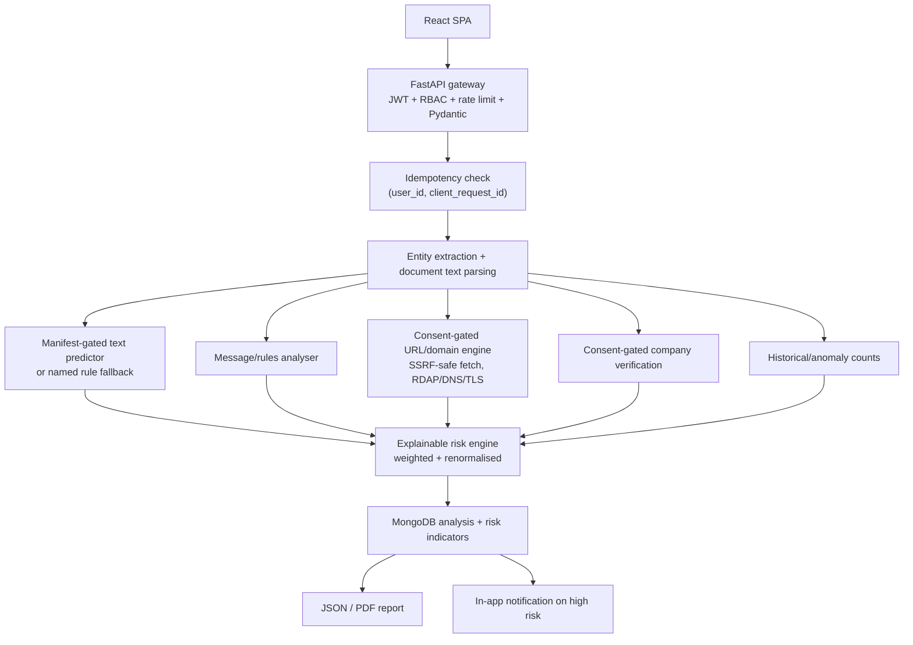

# TrustLens AI — Target Architecture and Implementation Mapping

**Status:** Stage 1 of the derived execution plan ([TRUSTLENS_ROADMAP.md](TRUSTLENS_ROADMAP.md)).
**Scope:** This document describes the architecture we are converging on and maps each layer to code that exists in this repository today. It is evidence-based: claims of existing functionality reference source paths. Planned capabilities are marked **PLANNED** and are not represented as working features.

## 1. Product contract

TrustLens AI accepts a URL, an offer/message text, or an image, and returns a structured, explainable assessment. The report states what was observed, which signals contributed, which sources were consulted and when, what could not be verified, and what the user should do next.

Non-negotiable invariants:

1. Absence of a scam record is **not** evidence of legitimacy.
2. A risk score is a decision-support signal, **not** a calibrated probability of fraud.
3. Missing evidence is recorded as missing, never as a clean result.
4. External providers report `not_configured` / `not_attempted` when unavailable; they are never simulated.
5. All submitted content and fetched page content are untrusted input.

The existing `HireShield AI` product in this repository is the implementation baseline. Its recruitment-fraud specialisation is retained as one offer category while the product identity and domain model broaden to all online offers.

## 2. Layer mapping

| Spec layer | Required capability | Current implementation | Gap / action |
| --- | --- | --- | --- |
| 1. User interface | React web app | `frontend/src/` — React 18 + TS + Vite + Tailwind; landing, auth, dashboard, scanner, report, company, monitoring, billing, admin, settings, legal pages | Rebrand copy; broaden scanner from jobs to offers (Stage 3). Extension and mobile are Stage 7. |
| 2. Security gateway | Validation, rate limiting, auth, abuse prevention, free local WAF point | FastAPI middleware in `backend/app/main.py`, security headers, TrustedHost, CORS; `enforce_rate_limit` and RBAC dependencies in `backend/app/api/deps.py`; Pydantic validation in `backend/app/schemas.py` | Rate limit is in-process and hard-coded; make it configurable and document a reverse-proxy WAF integration point (Stage 8). |
| 3. Identity and access | Registration, Argon2id, sessions, RBAC, recovery, deletion, object-level auth | `backend/app/api/routes/auth.py`, `backend/app/core/security.py`, `backend/app/api/deps.py`; JWT access/refresh with `jti` revocation; roles `user/student/staff/admin/owner`; ownership checks in services | Self-service account/data deletion and export are absent (Stage 8). |
| 4. Backend | Routing, orchestration, DB ops, reports, audit | `backend/app/main.py`, `backend/app/api/routes/*`, `backend/app/services/analysis_service.py`, `backend/app/utils/reporting.py`, `backend/app/db/repositories.py` | Add generic offer routes and report fields (Stages 3 and 5). |
| 5. Background processing | Redis/Celery when needed; local zero-cost mode | `backend/app/workers/celery_app.py` with eager in-process fallback; Compose defines Redis, worker and beat | Queue interface already modular; document local mode and add monitoring to Stage 8. |
| 6. Orchestrator | Job lifecycle, dispatch, normalise, score, persist, return | `AnalysisService.run()` in `backend/app/services/analysis_service.py` handles idempotency, extraction, engine dispatch, risk scoring, persistence and notification | Expose explicit stages and image/brand/threat engines (Stages 4–5). |
| 7A. URL intelligence | Structure, reputation, redirects, homograph, SSRF-safe fetching | `backend/app/intelligence/domain_analysis/analyser.py`, `backend/app/intelligence/url_scanning/safe_fetch.py`; RDAP/DNS/TLS without credentials; optional VirusTotal / Safe Browsing / Web Risk | Add homograph/typosquat heuristics and shortener handling to the passive URL analyser (Stage 4). |
| 7B. Text/NLP | Fraud language, urgency, payment demands, impersonation | `backend/app/intelligence/message_analysis/analyser.py`, `backend/app/intelligence/rules.py`, `backend/app/ml/` with manifest-gated TF-IDF models and rule fallbacks | Models are English recruitment-text only; label them accurately and avoid generic-offer claims. Add offer-category rules (Stage 3). |
| 7C. Image/OCR | Screenshot text, phone/URL/email/payment extraction | Document route accepts images but uses text extraction only; no OCR engine | **PLANNED** Stage 4: open-source OCR path with safe image handling. |
| 7D. Brand/verification | Entity vs official campaign vs impersonation | `backend/app/intelligence/company_verification/verifier.py` with registry intermediary and separate consent gate | **PLANNED** Stage 4: explicit verification states; never infer campaign authorisation from company existence. |
| 7E. Threat intelligence | Feed import, normalisation, dedupe, expiry, source registry | Optional providers inside domain analysis; no persistent indicator store | **PLANNED** Stage 4: normalised indicator collection, source registry, timestamps, expiry. |
| 8. Evidence/risk | Hybrid weighted scoring, dedupe, reliability, age, conflicting evidence, explainability | `backend/app/core/risk_engine.py`: six components, renormalisation over available components, evidence boosts, `inconclusive` flag, bands and recommended actions | Align initial weights to 30/25/25/10/10 and extend report schema (Stage 5). |
| 9. Persistence | 13 entities, indexes, constraints, retention, secure deletion | MongoDB collections with validators/indexes in `backend/app/db/mongo.py`; repositories in `backend/app/db/repositories.py`; **DB name `hireshield` retained deliberately** | Document deviation; add retention enforcement and self-service deletion (Stage 8). |
| 10. API | Versioned REST endpoints | All product routes under `/api/v1`; health, auth, analysis, reports, community feedback, intelligence, admin, system | Add `/analysis/offer` alias and threat/indicator endpoints (Stages 3–4). |
| 11. Security | OWASP controls, secure secrets, audit logs | Argon2id, JWT revocation, RBAC, upload validation, SSRF-resistant fetcher, audit logging, security headers, environment-only secrets | Stage 8: scanning, retention, configurable rate limiting, backup drill. |
| 12. Frontend design | Professional responsive cybersecurity SaaS UI | Existing Tailwind SPA with role-guarded routes, charts, 3D architecture scene, dark/light theme | Rebrand and broaden copy (Stages 2–3). |
| 13. Zero-cost policy | Free OSS stack, no paid API dependency | Python/FastAPI, MongoDB dev fallback, React/Vite, scikit-learn, optional external keys, no paid LLM | Maintained. Billing exists in the baseline but is optional and webhook-gated. |
| 14. ML workflow | Real training, honest evaluation, versioning | `backend/app/ml/`, `backend/scripts/train_models.py`, `backend/models/model_manifest.json`; approved job-text models with rejected-model audit trail | Recruitment-text only; document scope, keep rule fallbacks honest (Stage 3). |
| 15. Community | Reports, duplicates, moderation, weighting | Correction/feedback workflow stored as `pending_review`; notifications and monitoring | **PLANNED** Stage 6: distinct community reports, duplicate detection, reputation weighting, moderation states. |
| 16. DevOps | Logging, health, request IDs, config separation, backups | Structured logging, `/health` and `/api/v1/health`, request-scoped middleware, Compose, two CI workflows, docs | Stage 8: request IDs on reports, retention job, backup/restore drill. |

## 3. Runtime analysis flow (current)

Key behaviour: consent is a hard gate for external lookups; low coverage produces `inconclusive`; every indicator is persisted with its analysis id; failures leave a `failed` analysis record rather than a fabricated result.

## 4. Security boundaries

- **Network egress:** `SafeURLFetcher` validates scheme, host, port and every DNS answer, pins connections to validated public IPs, revalidates redirects, allows text content types only, and caps bytes and time. This is the SSRF/DNS-rebinding boundary for user-submitted URLs.
- **Uploads:** MIME allowlist, size cap, magic-byte checks and sanitised names in `backend/app/core/security.py` and the analysis route. Uploaded files are never executed.
- **Untrusted AI input:** no LLM is used for analysis. Deterministic rules and local scikit-learn models consume validated structured fields; structured Pydantic schemas validate outputs. Model instructions are not mixed with submitted content.
- **Authorisation:** role hierarchy and explicit ownership checks for analyses, reports and monitoring tasks; admin APIs require elevated roles.
- **Secrets:** environment-only; `public_dict()` masks secrets and `/system/config` exposes capability booleans only.

## 5. Documented deviations from the master specification

| Specification | This repository | Rationale |
| --- | --- | --- |
| SQLAlchemy + SQLite → PostgreSQL | MongoDB via PyMongo with a development-only in-memory fallback | Owner decision: preserve working repositories, validators, indexes and tests. |
| `TrustLens-AI/` directory layout | Existing flat `backend/`, `frontend/`, `docs/` layout | Owner decision: rebrand and extend in place; no disconnected second codebase. |
| No billing in specification | Razorpay/Stripe checkout exists in the baseline | Retained as an optional, webhook-gated capability; not part of the verification engine and never a source of truth for legitimacy. |
| Chrome extension / React Native app | Not implemented | Deferred to Stage 7 per the specification's own web-first sequencing. |
| Transformer / PaddleOCR / XGBoost in MVP | scikit-learn TF-IDF models plus rules; OCR XGBoost artifacts exist but are rejected/not active | Evidence-based: rejected models are documented and kept out of the active path; no fake capability claims. |

## 6. Traceability to stages

| Stage | Document | Exit evidence |
| --- | --- | --- |
| 1 — Architecture | This document + `TRUSTLENS_ROADMAP.md` | Document reviewed; baseline tests green |
| 2 — Rebrand | Source and docs | Frontend/backend test suites + production build + Compose config |
| 3 — Generic offers | `docs/API.md` | New offer path tests and legacy alias tests |
| 4 — Engines | `docs/ML.md`, `docs/API.md` | Per-engine unit tests, honest unavailable statuses |
| 5 — Risk/report | `docs/API.md` | Deterministic risk-engine tests and report-schema assertions |
| 6 — Community | `docs/API.md` | Moderation and weighting tests |
| 7 — Extension/mobile | `browser-extension/`, `mobile-app/` | Permission review and user-triggered analysis tests |
| 8 — Security/DevOps | `docs/SECURITY.md`, `docs/DEPLOYMENT.md` | Full verification commands and results |
