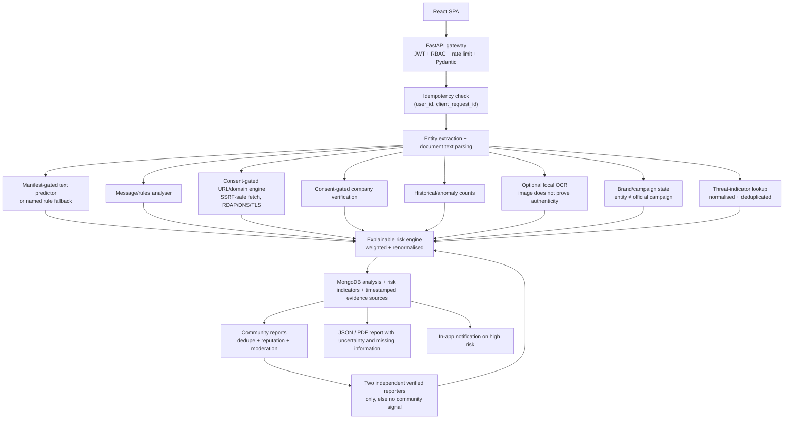

# TrustLens AI — Target Architecture and Implementation Mapping

**Status:** Stage 8 complete; all stages of the derived execution plan are delivered ([TRUSTLENS_ROADMAP.md](TRUSTLENS_ROADMAP.md)).
**Scope:** This document describes the architecture we are converging on and maps each layer to code that exists in this repository today. It is evidence-based: claims of existing functionality reference source paths. Planned capabilities are marked **PLANNED** and are not represented as working features.

## 1. Product contract

TrustLens AI accepts a URL, an offer/message text, or an image, and returns a structured, explainable assessment. The report states what was observed, which signals contributed, which sources were consulted and when, what could not be verified, and what the user should do next.

Non-negotiable invariants:

1. Absence of a scam record is **not** evidence of legitimacy.
2. A risk score is a decision-support signal, **not** a calibrated probability of fraud.
3. Missing evidence is recorded as missing, never as a clean result.
4. External providers report `not_configured` / `not_attempted` when unavailable; they are never simulated.
5. All submitted content and fetched page content are untrusted input.

The tested HireShield AI implementation was the engineering baseline, but it is **not** the product definition. The active product is defined in [TRUSTLENS_CONCEPT.md](../TRUSTLENS_CONCEPT.md): an evidence-led verification lens for any online offer, advert, message, link or screenshot. Recruitment fraud is retained as one offer category, never as the default identity.

## 2. Layer mapping

| Spec layer | Required capability | Current implementation | Gap / action |
| --- | --- | --- | --- |
| 1. User interface | React web app | `frontend/src/` — React 18 + TS + Vite + Tailwind; landing, auth, dashboard, scanner, report, company, monitoring, billing, admin, settings, legal pages; `browser-extension/` MV3 popup; `mobile-app/` plan | Stages 2–3 and 7 complete; mobile remains a documented plan, not a shipped app. |
| 2. Security gateway | Validation, rate limiting, auth, abuse prevention, free local WAF point | FastAPI middleware in `backend/app/main.py`, security headers, request IDs, TrustedHost, CORS; configurable `enforce_rate_limit` with `Retry-After` and RBAC dependencies in `backend/app/api/deps.py`; Pydantic validation in `backend/app/schemas.py` | Stage 8 complete for single-process rate limiting; a shared reverse-proxy/gateway limiter and WAF remain an operator responsibility. |
| 3. Identity and access | Registration, Argon2id, sessions, RBAC, recovery, deletion, object-level auth | `backend/app/api/routes/auth.py`, `backend/app/core/security.py`, `backend/app/api/deps.py`; JWT access/refresh with `jti` revocation; roles `user/student/staff/admin/owner`; ownership checks in services | Self-service account/data export and deletion remain out of scope; Stage 8 added config-driven retention instead. |
| 4. Backend | Routing, orchestration, DB ops, reports, audit | `backend/app/main.py`, `backend/app/api/routes/*`, `backend/app/services/analysis_service.py`, `backend/app/utils/reporting.py`, `backend/app/db/repositories.py` | Stages 3, 5 and 6 complete. |
| 5. Background processing | Redis/Celery when needed; local zero-cost mode | `backend/app/workers/celery_app.py` with eager in-process fallback and nightly `enforce-data-retention` beat entry; `cleanup_retention` task in `backend/app/workers/tasks.py`; Compose defines Redis, worker and beat | Stage 8 complete; queue depth/beat observability still requires operator monitoring. |
| 6. Orchestrator | Job lifecycle, dispatch, normalise, score, persist, return | `AnalysisService.run()` in `backend/app/services/analysis_service.py` handles idempotency, extraction, image/brand/threat/offer engine dispatch, canonical indicator deduplication, timestamped evidence sources, risk scoring, persistence and notification | Stage 5 complete; weights and report fields aligned. |
| 7A. URL intelligence | Structure, reputation, redirects, homograph, SSRF-safe fetching | `backend/app/intelligence/domain_analysis/analyser.py`, `backend/app/intelligence/url_scanning/safe_fetch.py`; RDAP/DNS/TLS without credentials; optional VirusTotal / Safe Browsing / Web Risk | Add homograph/typosquat heuristics and shortener handling to the passive URL analyser (Stage 4). |
| 7B. Text/NLP | Deception language, urgency, payment demands, impersonation | `backend/app/intelligence/message_analysis/analyser.py`, `backend/app/intelligence/rules.py`, `backend/app/ml/` with manifest-gated EMSCAD/DIFrauD TF-IDF models and rule fallbacks | Approved models are scoped to job/message text; generic offers remain rule-only. DIFrauD is a research benchmark with `production_grade=false`. |
| 7C. Image/OCR | Screenshot text, phone/URL/email/payment extraction | `backend/app/intelligence/image/ocr.py`: optional local tesseract path, image validation, capped dimensions, labelled observations; wired into document uploads | Real OCR requires a local `tesseract` binary; otherwise the engine reports `not_configured`. |
| 7D. Brand/verification | Entity vs official campaign vs impersonation | `backend/app/intelligence/brand_verification/verifier.py` plus consent-gated `CompanyVerifier`; explicit four-state campaign model | No campaign is verified from a logo, screenshot, registry match or advert text alone. |
| 7E. Threat intelligence | Feed import, normalisation, dedupe, expiry, source registry | `backend/app/intelligence/threat_indicators/store.py` with MongoDB collections, admin source registry, optional SSRF-safe JSON feed refresh and TTL | No feed is configured by default; unmatched lookups are never presented as clean results. |
| 8. Evidence/risk | Hybrid weighted scoring, dedupe, reliability, age, conflicting evidence, explainability | `backend/app/core/risk_engine.py`: five categories (30/25/25/10/10), renormalisation over available categories, evidence boosts, `inconclusive` flag, configurable bands, `uncertainty` and recommended actions | Stage 5 complete; empty checks remain unavailable rather than clean. |
| 9. Persistence | 13 entities, indexes, constraints, retention, secure deletion | MongoDB collections with validators/indexes in `backend/app/db/mongo.py`; repositories in `backend/app/db/repositories.py`; `backend/app/services/retention_service.py` purges by configured policy; **DB name `hireshield` retained deliberately** | Stage 8 retention enforcement complete; self-service deletion remains out of scope. |
| 10. API | Versioned REST endpoints | All product routes under `/api/v1`; health, auth, analysis, reports, community feedback, intelligence, admin, threat-indicator registry, system | Stage 5 structured report fields delivered. |
| 11. Security | OWASP controls, secure secrets, audit logs | Argon2id, JWT revocation, RBAC, upload validation, SSRF-resistant fetcher, audit logging, security headers, environment-only secrets, tracked-file secret scan, dependency-audit CI | Stage 8 complete; two Python advisories without published fixes and two moderate npm advisories are documented as open risks. |
| 12. Frontend design | Professional responsive cybersecurity SaaS UI | Offer-first Tailwind SPA with role-guarded routes, charts, 3D architecture scene, dark/light theme | Active copy follows [TRUSTLENS_CONCEPT.md](../TRUSTLENS_CONCEPT.md); recruitment is one scanner category. |
| 13. Zero-cost policy | Free OSS stack, no paid API dependency | Python/FastAPI, MongoDB dev fallback, React/Vite, scikit-learn, optional external keys, no paid LLM | Maintained. Billing exists in the baseline but is optional and webhook-gated. |
| 14. ML workflow | Real training, honest evaluation, versioning | `backend/app/ml/`, `backend/scripts/train_models.py`, `backend/models/model_manifest.json`; approved EMSCAD and optional DIFrauD families with rejected-model audit trail | Scope is documented per family; generic offers stay rule-only and DIFrauD limitations are explicit. |
| 15. Community | Reports, duplicates, moderation, weighting | `backend/app/services/community_service.py`: distinct correction/community categories, stable `entity_key`, claim/dedupe/duplicate-group keys, bounded reputation snapshots, audited moderator state machine, corroboration gate; admin review UI in `AdminPage.tsx` | Stage 6 complete: one report never changes risk class; two independent moderator-verified reporters required for a suspicious, non-proof community indicator. |
| 16. DevOps | Logging, health, request IDs, config separation, backups | `X-Request-ID` + `ctx_*` structured logs, both health endpoints, `scripts/backup_tool.py` backup/verify/restore, config-driven retention, Compose, five CI jobs in `ci.yml`, Dependabot, docs | Stage 8 complete; production TLS/proxy and shared rate limiting remain deployment responsibilities. |

## 3. Runtime analysis flow (current)

Key behaviour: consent is a hard gate for external lookups; low coverage produces `inconclusive`; every indicator is persisted with its analysis id; failures leave a `failed` analysis record rather than a fabricated result. Community reports are submitted against a stored analysis, deduplicated per reporter/entity/claim and moderated; subsequent analyses consult the corroboration gate, which requires at least two independent moderator-verified reporters before emitting any community indicator. A single report never changes a risk classification.

## 4. Security boundaries

- **Network egress:** `SafeURLFetcher` validates scheme, host, port and every DNS answer, pins connections to validated public IPs, revalidates redirects, allows text content types only, and caps bytes and time. This is the SSRF/DNS-rebinding boundary for user-submitted URLs.
- **Uploads:** MIME allowlist, size cap, magic-byte checks and sanitised names in `backend/app/core/security.py` and the analysis route. Uploaded files are never executed.
- **Untrusted AI input:** no LLM is used for analysis. Deterministic rules and local scikit-learn models consume validated structured fields; structured Pydantic schemas validate outputs. Model instructions are not mixed with submitted content.
- **Authorisation:** role hierarchy and explicit ownership checks for analyses, reports and monitoring tasks; admin APIs require elevated roles. Moderation is admin/owner-only; false-report decisions require a recorded reason; every decision is audited with previous/new state so a single user claim cannot silently reclassify an entity. Reporter reputation is derived from audited outcomes, stored as a snapshot and used only as a weighting input.
- **Secrets:** environment-only; `public_dict()` masks secrets and `/system/config` exposes capability booleans only. `scripts/secret_scan.py` blocks tracked `.env`/backup files and credential patterns; CI runs it as a blocking check.
- **Correlation:** every response carries `X-Request-ID`; caller-supplied values must be short opaque tokens, otherwise a server-generated id is used. The id is exposed to allowed CORS clients and written to structured `ctx_*` log fields.
- **Retention and recovery:** `enforce_retention()` deletes only documents older than their configured policy timestamp, records one audit event per run, and is scheduled by Celery beat and exposed through an admin-only task trigger. Logical backups use checksummed JSONL and restore refuses to run without `--confirm`.

## 5. Documented deviations from the master specification

| Specification | This repository | Rationale |
| --- | --- | --- |
| SQLAlchemy + SQLite → PostgreSQL | MongoDB via PyMongo with a development-only in-memory fallback | Owner decision: preserve working repositories, validators, indexes and tests. |
| `TrustLens-AI/` directory layout | Existing flat `backend/`, `frontend/`, `docs/` layout | Owner decision: rebrand and extend in place; no disconnected second codebase. |
| No billing in specification | Razorpay/Stripe checkout exists in the baseline | Retained as an optional, webhook-gated capability; not part of the verification engine and never a source of truth for legitimacy. |
| Chrome extension / React Native app | MV3 browser extension delivered; React Native remains a documented plan | Stage 7 followed web-first sequencing. The extension is user-triggered with minimal permissions; no mobile code or permission is claimed. |
| Transformer / PaddleOCR / XGBoost in MVP | scikit-learn TF-IDF models plus rules; OCR XGBoost artifacts exist but are rejected/not active | Evidence-based: rejected models are documented and kept out of the active path; no fake capability claims. |

## 6. Traceability to stages

| Stage | Document | Exit evidence |
| --- | --- | --- |
| 1 — Architecture | This document + `TRUSTLENS_ROADMAP.md` | Document reviewed; baseline tests green |
| 2 — Rebrand | Source and docs | Frontend/backend test suites + production build + Compose config |
| 3 — Generic offers | `docs/API.md` | New offer path tests and legacy alias tests |
| 4 — Engines | `docs/ML.md`, `docs/API.md` | Per-engine unit tests, honest unavailable statuses |
| 5 — Risk/report | `docs/API.md` | Deterministic risk-engine tests and report-schema assertions |
| 6 — Community | `docs/API.md` | Moderation and weighting tests |
| 7 — Extension/mobile | `browser-extension/`, `mobile-app/` | 6 extension permission/contract tests; mobile policy document |
| 8 — Security/DevOps | `docs/SECURITY.md`, `docs/RETENTION.md`, `docs/ENVIRONMENTS.md`, `docs/DEPLOYMENT.md` | 111 backend / 29 frontend / 6 extension tests, production build, Compose config, Ruff, compileall, secret scan, pip/npm audits |
